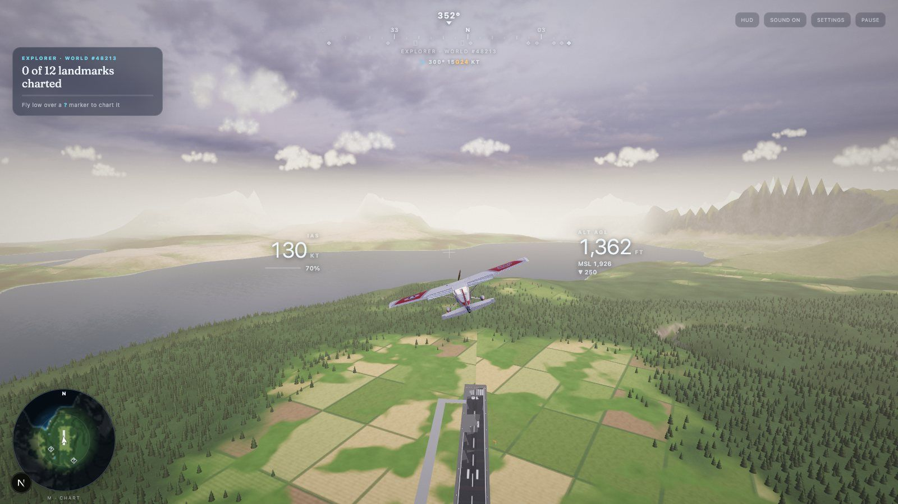
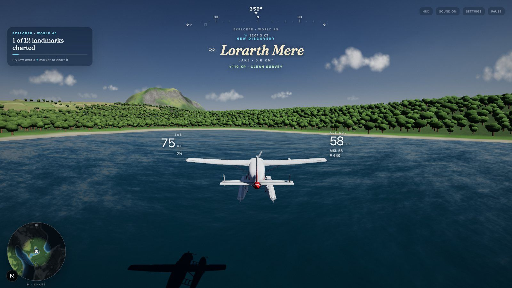
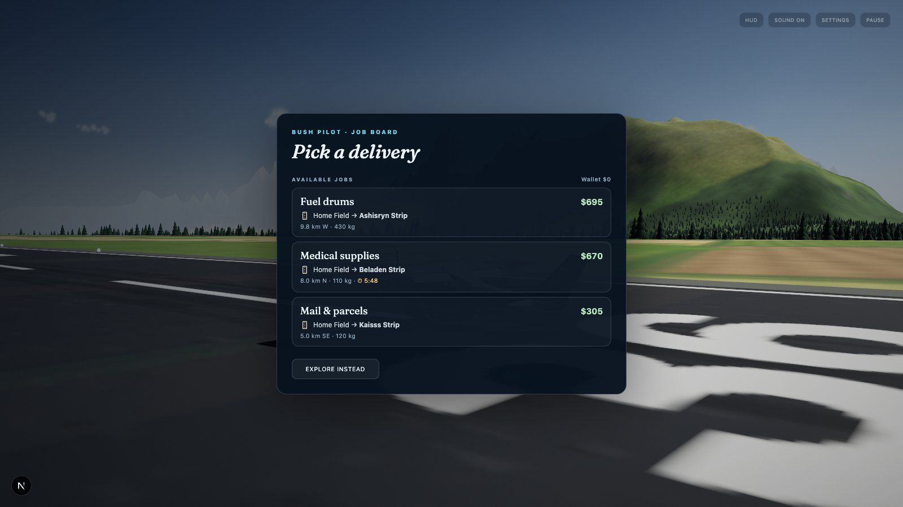
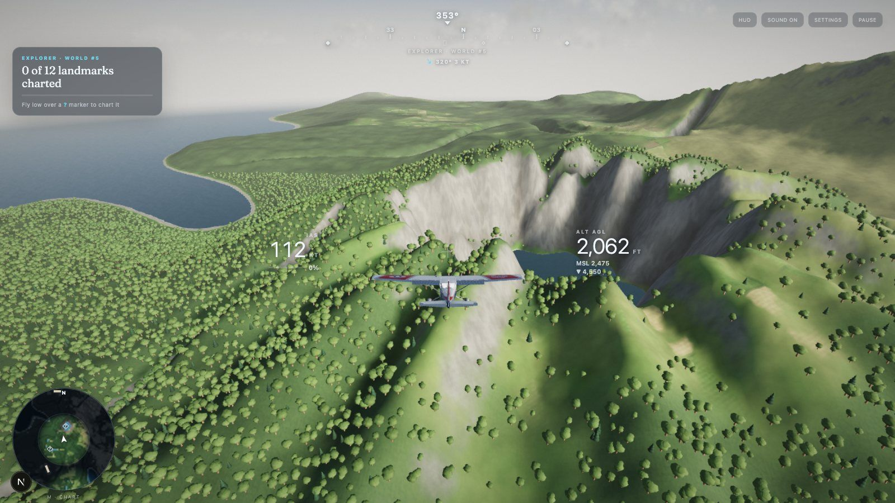
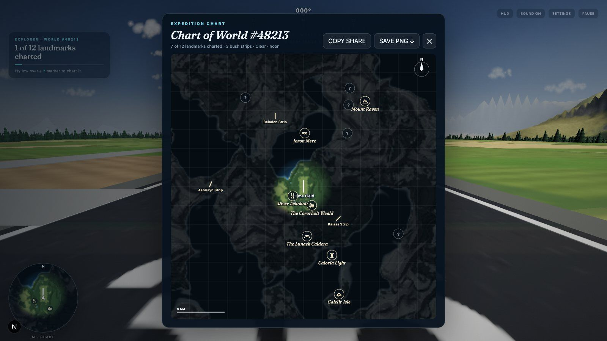
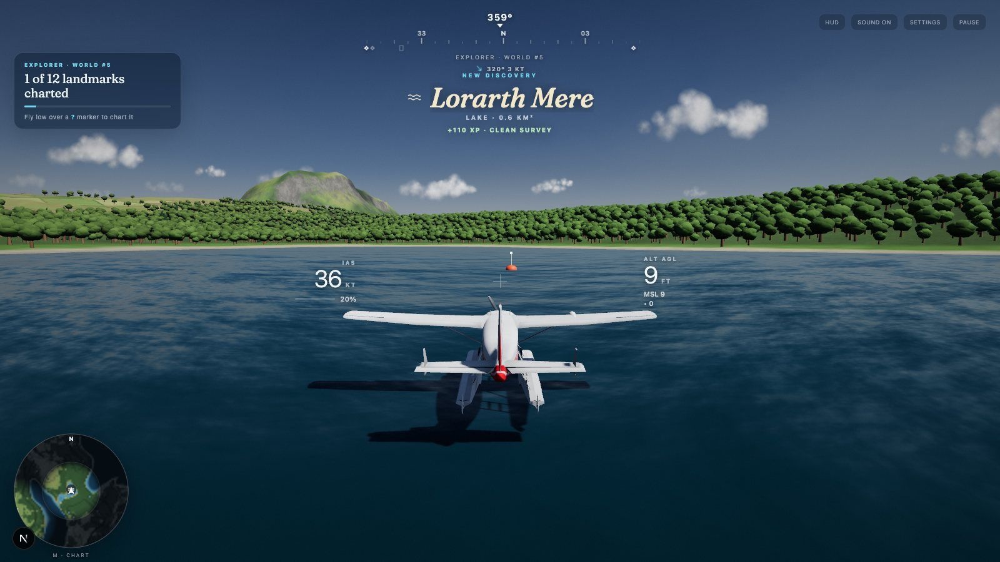
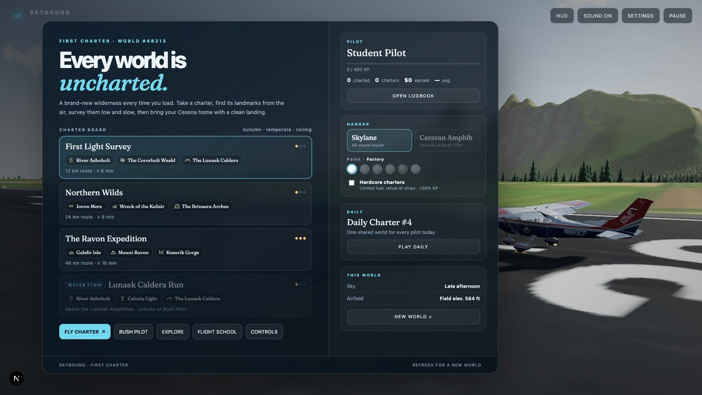
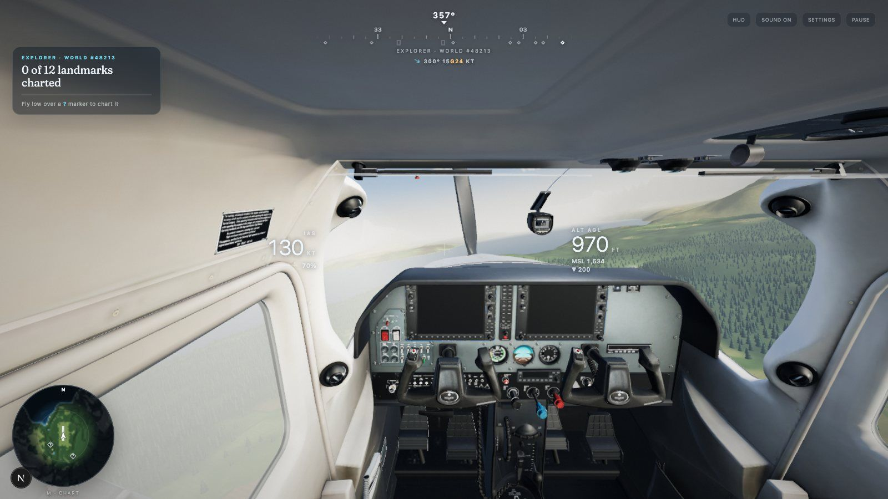
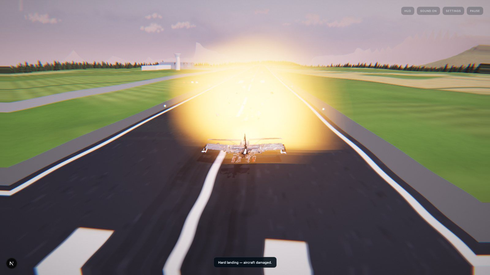

# SKYBOUND

**A bush-flying exploration game. Every world is uncharted, and you're the first pilot to fly it.**

Each time you load the page a new wilderness is generated: coastlines, mountain ranges, rivers, forests, crater lakes and sea stacks that no one has seen before. Take survey charters, find and name its landmarks, haul cargo between grass strips, and bring your Cessna home with a clean landing.

**▶ Play free in your browser: [eeman1113.github.io/flydome](https://eeman1113.github.io/flydome/)**
Needs a laptop or desktop with Chrome or Edge. Keyboard and mouse, or a DualSense controller.



## The game

You're a survey pilot. Every world starts as a blank, fogged-out chart, and your job is to fill it in.

1. **Take a charter.** The charter board offers routes through three real landmarks of this world, all found in the terrain itself: a summit, a lake, a gorge, a lighthouse on a cape, an old wreck in the hills.
2. **Fly out and survey them.** Each landmark has a survey envelope, such as low over the water, close past the summit, or down inside the gorge. Hold a steady pass until the ring fills and the landmark is inked onto your chart with its new name.
3. **Bring it home.** Land at the home field or any bush strip to file the charter. Every landing is graded **S to D** on sink rate, centreline, alignment and bounces, so a butter landing is worth real XP.
4. **Climb the ranks.** XP takes you from Student Pilot to Chief Cartographer. Ranks unlock a second aircraft, new paint schemes and harder work.

A crash keeps your discoveries but loses the charter's landing bonus, and you restart at the last strip you landed on.



### Game modes

| Mode | What you do |
|---|---|
| **Charters** | Survey three named landmarks, then land at a strip. Three charters per world, from a short first-light hop to a long-range expedition. |
| **Water strip charters** | Amphibian only. Survey the lakes, rivers and coast, then alight on the named lake to file the charter. |
| **Bush Pilot** | A job board of deliveries between bush strips, the home field and charted lakes: fuel drums, mail, survey crews and timed medical runs. Heavy cargo really does climb slower. You're paid on landing, then pick the next job from wherever you are. |
| **Explore** | No route, no clock. Chart the whole world at your own pace, then share your result, e.g. `World #48213: 7/12 discovered`. |
| **Daily Charter** | One world and one route for every pilot each day, with a shareable result and a ghost of your best run to race. |
| **Flight School** | Ten short lessons, from throttle and takeoff to surveying a landmark and landing on a grass strip. Start here if you've never flown. |



### What's out there

Every world is generated from a seed and scanned for up to twelve landmarks, each one named:

- **Summits, mountain passes and gorge runs**: thread a gorge end to end below its rims.
- **Lakes and crater lakes**: water inside the rim of an old volcanic cone, and a perfect place to land the amphibian.
- **Rivers, forests and islands.**
- **Coastal waterfalls, sea stacks and arches, capes and lighthouses** (the lighthouse beam sweeps at dusk).
- **Glaciers and lone rock spires.**
- **Plane wrecks and stone arches**: rare finds out in the wilds.

Rare finds earn their own logbook stamp. Every charted landmark gets a survey beacon (a cairn and pennant, or a buoy on water). Press **M** for the expedition chart and save it as a PNG.





### Aircraft and progression

- **Cessna 182 Skylane.** Your first aircraft: a dependable all-round tourer.
- **Cessna 208 Caravan Amphibian.** Unlocks at **Bush Pilot** rank. It lands on lakes as well as runways, opens water strip charters, and turns charted lakes into cargo destinations.
- **Paint schemes.** Six liveries, unlocked by rank, up to Cartographer Gold.
- **A secret.** There is a third aircraft. Old-school cheat codes still work.
- **Hardcore charters.** An optional limited-fuel mode: the tank is sized to the route, you refuel by stopping at a strip, and you earn +50% XP.

Your **pilot logbook** saves in the browser and carries across every world: rank, flight time, discovery stamps, landing grades, deliveries and earnings.



### Skybound Ground

You're never flying alone. **Skybound Ground**, the controller back at the home field, is on the radio for the whole flight:
- **On the ground:** she clears you for takeoff with the live wind and weather.
- **On a charter:** she gives you the bearing and range to each target, talks you through survey passes, and cheers the rare finds.
- **Landing:** she clears you to land, warns you when you're high, low or fast on final, and grades your touchdown out loud.
- **Emergencies:** she shouts when you stall or get too close to the ground, and calls a mayday when it all goes wrong.
- **Flight School:** she teaches every lesson.

Each call is built from hundreds of recorded variants (callsigns, numbers, landmark types and lines for every situation), so she rarely repeats herself. Everything plays through a live radio filter with static and squelch. Other pilots chat on the frequency in the background. Every transmission is subtitled, and **Settings** lets you turn the radio, the chatter or the subtitles off.

### A new world every time

**Refresh for a brand-new world.** The address bar always carries the world's seed (`?seed=48213`), so you can send a friend the exact world you flew. **Resume last world** on the menu takes you back to where you left off. Each world also rolls its own season, sky and weather: seven real HDR skies from dawn to dusk, gusting wind you can feel in the controls, low cloud, and rain on overcast days, with drops on the windshield.



## How to fly

**Taking off:** hold **Shift** to full throttle. At about 58 kt, ease back with **W** to around 10° nose-up, and she flies at about 60 kt. Climb at 80 to 85 kt.

**Landing:** line up with a strip and the approach guide appears, with a glideslope and centreline cue. Come in slow (about 65 kt) and lose height steadily, then pull the throttle to idle and flare just above the ground. On a grass strip, stop with plenty of room to spare.

| Action | Keyboard + mouse | DualSense |
|---|---|---|
| Pitch up / down | W / S or ↑ / ↓ | Left stick |
| Roll left / right | A / D or ← / → | Left stick |
| Rudder left / right | Q / E | L1 / R1 |
| Throttle up / down | Shift / Ctrl | R2 / L2 |
| Camera (cockpit, chase, orbit, free look) | 1–4, C to cycle | ○, D-pad |
| Steer like a joystick | Hold left mouse + drag | — |
| Look around | Hold right mouse + drag | Right stick |
| Expedition chart | M | Touchpad |
| Minimap zoom | N or scroll | Create |
| Photo mode (orbit, depth of field, PNG) | P | — |
| HUD on / off | H | □ |
| Pause | Esc / Space | OPTIONS |

**DualSense:** pair it over Bluetooth or USB, then click the page and press a button. For gyro yaw, open **Settings → Pair DualSense Gyro** and calibrate it while holding the controller still. This needs desktop Chrome or Edge.



## Under the hood

SKYBOUND is built with **three.js** and **Next.js**, runs entirely in the browser, and is deployed as a static site on GitHub Pages.

- **Procedural terrain.** Seeded, domain-warped continents, ridged mountains, rivers, lakes, volcanic craters, climate and seasons. Terrain streams in Web Workers with distance LOD, baked self-shadowing and ambient occlusion, and a splatting shader.
- **Physically calibrated HDR skies.** The sun is located and integrated from each CC0 HDRI, so light, exposure and fog all match the sky. Clouds also cast shadows on the ground.
- **A real flight model.** Lift, induced drag, ground effect, progressive stall (optional: by default the game uses a **forgiving flight model** where the aircraft never stalls or sinks unless you point the nose down; switch on **Stall simulation** in Settings for the real thing), propeller thrust that falls with airspeed, and density altitude, all tuned against the Cessna 182's real numbers (about 270 m to clear the runway, about 1,000 fpm climb, about 145 kt cruise at 75% power). Barrel rolls are allowed.
- **Crashes.** A fireball, a smoke plume that drifts with the wind, parts torn away with physics, a crumpled airframe and a shock-distortion pulse.
- **Automatic quality.** The game detects your GPU, then a runtime governor tunes render scale, view distance (4–20 km) and effects to hold the frame rate.
- **Procedural audio.** The engine, propeller and airflow are synthesised live. So are the sound effects: tyre chirps on touchdown, rumble on grass strips, spray on the floats, the reed stall horn, gust buffeting, rain on the airframe, thunder, the starter and engine catch, crash impacts, fire and debris, and UI clicks.
- **The radio.** Over 400 voice clips were generated offline on a GPU with Orpheus TTS (`tools/radio/`). Each line was rendered four times, and Whisper transcribed every take so the clip closest to the script won. The game assembles calls from these clips and runs them through a band-pass, saturation, compression and static chain in Web Audio.



### Run it locally

Requires Node.js 20+.

```bash
npm install
npm run dev          # http://localhost:3000
npm run build        # static export to out/ (webpack)
```

URL options: `?seed=12345` (a specific world), `?sky=belfast` (force a sky), `?daily=1` (today's Daily Charter), `?debug` (exposes `window.SKYB`). Every push to `main` is deployed by `.github/workflows/pages.yml`.

<details>
<summary>Project layout</summary>

```
app/                 Next.js App Router: page, game UI, handheld notice, styles
src/game/
  engine.js          renderer, scene, post-processing, aircraft, frame loop
  terrainLib.js      seeded terrain, climate, strips, craters, landmark scanner
  terrain.worker.js  Web Worker that builds terrain chunks
  chunks.js          chunk streaming, LOD, forests, ground queries
  sky.js             HDR loading and sun/exposure calibration
  materials.js       terrain, water, tree and cloud shaders
  scenery.js         water, clouds, airfield, bush strips, landmark props, beacons
  physics.js         flight model
  survey.js          charters, survey envelopes, landing grades, cargo jobs
  hud.js             compass tape, minimap, cards, banners, expedition chart
  menu.js            charter board, pilot card, hangar, logbook
  progress.js        pilot logbook (localStorage)
  weather.js         wind, gusts, rain, windshield drops, ambience
  radio.js           Skybound Ground: call assembly, radio filter, subtitles, chatter
  sfx.js             synthesised sound effects
  crash.js           fire, smoke, debris, deformation
  photo.js           photo mode
  ghost.js           Daily Charter ghost replays
  tutorial.js        Flight School
  camera.js, input.js, audio.js, perf.js, icons.js, ui.js
public/models/       aircraft (glTF, meshopt + WebP compressed)
public/skies/        CC0 HDR skies
public/radio/        Skybound Ground voice clips (Opus) + manifest
public/screenshots/  the images on this page
tools/radio/         radio script (lines.py) and GPU voice generator (gen.py)
```

</details>

## Credits

### 3D models

**Cessna 182 Skylane**
- **Model:** "[Cessna 182 Skylane](https://sketchfab.com/3d-models/cessna-182-skylane-2dde31b1aa8f484f96bb7ee9d9c5ad26)" by **[VTX](https://sketchfab.com/VTX_car)** on Sketchfab.
- **Licence:** [Creative Commons Attribution-NonCommercial-ShareAlike 4.0](https://creativecommons.org/licenses/by-nc-sa/4.0/) (CC BY-NC-SA 4.0).
- **Changes:** converted and compressed with glTF-Transform (meshopt geometry, WebP textures), with the propeller separated for animation. In-game, paint schemes are applied as a tint.
- **Terms:** this adapted model is shared under the same licence and may not be used commercially.

**Cessna 208 Caravan Amphibian**
- **Model:** "[CaravanA](https://sketchfab.com/3d-models/caravanazip-125yIM3DWOvlzV70NvXjZElRdel)" by **[helijah](https://sketchfab.com/helijah)** on Sketchfab.
- **Licence:** [Creative Commons Attribution 4.0](https://creativecommons.org/licenses/by/4.0/) (CC BY 4.0).
- **Changes:** converted from OBJ to glTF and compressed with glTF-Transform, with the propeller split into blades plus a motion-blur disc. In-game, paint schemes are applied as a tint.

**F-16 Fighting Falcon** (a secret aircraft)
- **Model:** "[F-16 Fighting Falcon - Fighter Jet - Free](https://sketchfab.com/3d-models/f-16-fighting-falcon-fighter-jet-free-f0b00989e5634764848ef2c235c64db5)" by **[bohmerang](https://sketchfab.com/bohmerang)** on Sketchfab.
- **Licence:** [CC BY-NC-SA 4.0](https://creativecommons.org/licenses/by-nc-sa/4.0/).
- **Changes:** compressed with glTF-Transform (meshopt geometry, WebP textures). The afterburner, heat haze, vapour cone and engine sound are the game's own.

All other 3D content (terrain, trees, clouds, the airfield, cabins, windsocks, beacons, lighthouses, arches, sea stacks and the plane wreck) is generated procedurally in code.

### Skies

CC0 HDRIs from [Poly Haven](https://polyhaven.com):

| Sky | Authors |
|---|---|
| [Kloofendal 48d Partly Cloudy (Pure Sky)](https://polyhaven.com/a/kloofendal_48d_partly_cloudy_puresky) | Greg Zaal, Jarod Guest |
| [Kloofendal Overcast (Pure Sky)](https://polyhaven.com/a/kloofendal_overcast_puresky) | Greg Zaal |
| [Qwantani Dawn (Pure Sky)](https://polyhaven.com/a/qwantani_dawn_puresky) | Greg Zaal, Jarod Guest |
| [Qwantani Noon (Pure Sky)](https://polyhaven.com/a/qwantani_noon_puresky) | Greg Zaal, Jarod Guest |
| [Qwantani Late Afternoon (Pure Sky)](https://polyhaven.com/a/qwantani_late_afternoon_puresky) | Greg Zaal, Jarod Guest |
| [Qwantani Dusk 2 (Pure Sky)](https://polyhaven.com/a/qwantani_dusk_2_puresky) | Greg Zaal, Jarod Guest |
| [Belfast Sunset (Pure Sky)](https://polyhaven.com/a/belfast_sunset_puresky) | Greg Zaal, Dimitrios Savva, Jarod Guest |

### Voices

The radio voices were generated with [Orpheus TTS](https://github.com/canopyai/Orpheus-TTS) by Canopy Labs (Apache-2.0; weights via [unsloth/orpheus-3b-0.1-ft](https://huggingface.co/unsloth/orpheus-3b-0.1-ft)), decoded with [SNAC](https://github.com/hubertsiuzdak/snac) (MIT), and checked with OpenAI [Whisper](https://github.com/openai/whisper) large-v3-turbo (MIT). The script and the generator are in `tools/radio/`.

### Software and fonts

- [three.js](https://threejs.org) (MIT), [Next.js](https://nextjs.org) and [React](https://react.dev) (MIT), [marked](https://marked.js.org) (MIT), [glTF-Transform](https://gltf-transform.dev) (MIT) and [meshoptimizer](https://github.com/zeux/meshoptimizer) (MIT).
- [Fraunces](https://fonts.google.com/specimen/Fraunces) via Google Fonts (SIL Open Font License).

SKYBOUND is a game, not a certified flight-training tool. The Cessna names refer to the real aircraft the models depict, and the game is not affiliated with or endorsed by Textron Aviation.
